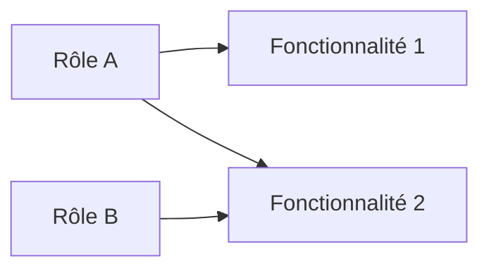

<!-- spec-meta
repo: owner/repo
service: Nom lisible du service
chemins:
  - sous-dossier/
  - autre-dossier/partagé/
url_prod: https://exemple.gouv.fr/
destination: docs/specs/nom-du-service.md
cadence: mensuelle          # hebdo | mensuelle | trimestrielle | a-chaque-release | manuelle
commit_reference: <sha complet de HEAD au moment de la révision>
derniere_revision: AAAA-MM-JJ
derniere_verification_prod: AAAA-MM-JJ   # ou "aucune"
redacteur: skill spec-fonctionnelle-github
-->

# Spécification fonctionnelle — <Nom du service>

> **Comment lire ce document.** Le texte principal se lit sans connaissance technique : il décrit ce que fait le service, pour qui, et les choix qui ont été faits. Les blocs repliés « ▸ Détails techniques » s'adressent aux développeurs et aux PM qui veulent savoir où et comment c'est implémenté. Vous pouvez les ignorer sans rien perdre du propos.
>
> **D'où viennent les informations.** Chaque point important porte l'une de ces mentions :
> `lu dans le code` — constaté dans le dépôt `owner/repo` au commit indiqué en en-tête ·
> `vérifié en prod` — observé sur le service en production à la date indiquée ·
> `déduit` — interprétation raisonnable, non confirmée.

---

## 1. En un coup d'œil

Trois à cinq phrases : ce que le service rend possible, pour qui, et sa place dans l'écosystème (de quoi il dépend, qui dépend de lui). Un lecteur pressé s'arrête ici.

| | |
|---|---|
| **URL** | https://… |
| **Public** | … |
| **Dépend de** | … (API, base, service d'identité…) |
| **Alimente** | … |
| **Code source** | `owner/repo` — `chemin/` |

<details>
<summary>▸ Détails techniques — stack et périmètre du code</summary>

| Élément | Valeur | Source |
|---|---|---|
| Framework / langage | | `package.json`, … |
| Rendu / UI | | |
| Données | | |
| Authentification | | |
| Analytics / observabilité | | |
| Dossiers concernés | | |

</details>

## 2. Pour qui, pour quoi

Les types d'utilisateurs et ce que chacun vient faire. Un tableau suffit souvent :

| Utilisateur | Ce qu'il vient faire | Ce qu'il ne peut pas faire |
|---|---|---|
| | | |

## 3. Accès et connexion

Comment on entre dans le service (compte, identité déléguée, clé d'API…), ce qui se passe à la première connexion, ce qui arrive quand on n'a pas de compte.

<details>
<summary>▸ Détails techniques — authentification et session</summary>

Mécanisme, durée de session, où est vérifié le droit d'accès, fichiers concernés.

</details>

## 4. Fonctionnalités

Une sous-section par grande fonctionnalité, dans l'ordre où un utilisateur les rencontre. Pour chacune :

### 4.x <Nom de la fonctionnalité>

**Ce qu'elle permet.** Une ou deux phrases.

**Pour qui.** Les types d'utilisateurs qui y ont accès.

**Comment ça se passe.** Le parcours, en quelques étapes, tel qu'un utilisateur le vit.

**Règles de gestion.** Les règles qui gouvernent la fonctionnalité, en phrases : seuils, statuts, exclusions, cas particuliers, ce qui se passe en cas d'erreur. C'est la partie la plus utile aux parties prenantes et la plus souvent absente des autres documents.

Capture d'écran si elle aide (sans donnée personnelle) :


<details>
<summary>▸ Détails techniques — <nom de la fonctionnalité></summary>

- Routes / écrans : `…`
- Composants ou modules : `…`
- Données manipulées : interface ou schéma, en bloc de code si court
- Appels externes : `…`
- Configuration : variables d'environnement, flags
- Points d'attention : dette, fragilité, comportement non évident

</details>

## 5. Rôles et droits

Qui voit quoi, qui peut faire quoi. Un diagramme Mermaid rend souvent service ici :



<details>
<summary>▸ Détails techniques — implémentation des droits</summary>

Où les rôles sont définis, où la visibilité est calculée, comment un rôle est attribué.

</details>

## 6. Choix réalisés et limites connues

La section que les nouveaux arrivants cherchent et ne trouvent jamais. Lister les choix structurants avec leur conséquence visible, et quand on la connaît, la raison :

| Choix | Conséquence pour l'utilisateur | Raison connue | Statut |
|---|---|---|---|
| Ex. : pas de base de données propre | Toute donnée vient de l'API centrale ; pas de fonctionnement dégradé | Un seul référentiel | `lu dans le code` |
| Ex. : fonctionnalité X développée mais désactivée | Invisible pour l'utilisateur, accès direct redirigé | — | `vérifié en prod le JJ/MM/AAAA` |

## 7. Fonctionnalités en préparation ou désactivées

Ce qui existe dans le code sans être actif (flags, branches de fonctionnalité, routes non reliées). Les présenter comme telles — ni comme des fonctionnalités disponibles, ni comme absentes.

## 8. Structure du code (pour les tech)

<details open>
<summary>▸ Arborescence commentée</summary>

```
chemin/
├── …            # rôle du dossier
└── …
```

</details>

<details>
<summary>▸ Modèle de données</summary>

Interfaces ou schémas principaux, avec les champs qui ont une signification métier.

</details>

<details>
<summary>▸ Configuration et environnements</summary>

Variables d'environnement, flags, différences entre environnements si elles sont visibles dans le code.

</details>

<details>
<summary>▸ Points d'attention pour qui reprend le code</summary>

Dette, dépendances fragiles, zones non testées, comportements à connaître avant de modifier.

</details>

## 9. Glossaire

| Terme | Définition dans le contexte de ce service |
|---|---|
| | |

---

## Journal des révisions

| Date | Commit de référence | Nature | Changements fonctionnels notables |
|---|---|---|---|
| AAAA-MM-JJ | `sha court` | Création | Première version, vérifiée en prod le … |
