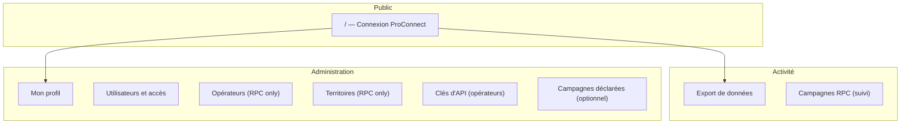

<!-- spec-meta
repo: covoiturage-gouv-fr/mono
service: Espace partenaire
chemins:
  - app-partners/
url_prod: https://partenaire.covoiturage.beta.gouv.fr/
destination: specs/espace-partenaire.md
cadence: mensuelle
commit_reference: 454926413599cb25c589c600a456799911b8294b
derniere_revision: 2026-11-23
derniere_verification_prod: 2026-11-23
redacteur: skill spec-fonctionnelle-github
-->

# Spec — Espace Partenaire (partenaire.covoiturage.beta.gouv.fr)

*Document de présentation à destination des parties prenantes. Établi à partir du code source (`app-partners`, repo [covoiturage-gouv-fr/mono](https://github.com/covoiturage-gouv-fr/mono)) et du site en production au 23/11/2026.*

---

## 1. Qu'est-ce que l'espace partenaire ?

L'espace partenaire est le portail web par lequel les **collectivités (AOM)** et les **opérateurs de covoiturage** pilotent et suivent leurs dispositifs d'incitation, accèdent à leurs données de trajets, et gèrent leurs accès à l'écosystème covoiturage.beta.gouv.fr. C'est l'un des points de contact directs entre le Registre de Preuve de Covoiturage (RPC) et ses ~370 incitateurs actifs (170 AOM, 200 entreprises).

URL : https://partenaire.covoiturage.beta.gouv.fr/
Code source : `app-partners/` dans le monorepo `covoiturage-gouv-fr/mono`

### Pour qui ?

| Profil | Ce qu'il vient faire |
|---|---|
| **Collectivité / AOM (territoire)** | Suivre ses campagnes d'incitation, exporter ses données de trajets, gérer les accès de son équipe |
| **Opérateur de covoiturage** | Exporter ses données, gérer ses clés d'API, déclarer des campagnes, gérer ses comptes utilisateurs |
| **Équipe RPC (registry.admin)** | Administration globale : opérateurs, territoires, utilisateurs, validation des campagnes déclarées, simulation de compte pour support |

### Connexion

L'authentification se fait exclusivement via **ProConnect** (identité numérique de l'État). Il n'y a pas de couple identifiant/mot de passe propre à l'application. Deux parcours de création de compte sont documentés depuis la page d'accueil : un pour les collectivités, un pour les opérateurs.


*Capture vérifiée en production le 23/11/2026.*

---

## 2. Fonctionnalités

### 2.1 Activité

#### Export de données de trajets
Génération d'un export CSV des trajets de covoiturage labellisés par le RPC, filtré par :
- **Période** (max. ~2 ans en arrière, jusqu'à J-5)
- **Périmètre géographique** (recherche par commune, EPCI, département, région) ou **périmètre d'une campagne** (sélection directe d'un territoire suivi), selon le profil
- Pour un opérateur : export limité à ses propres trajets
- Pour une collectivité : périmètre figé sur son territoire

L'export est envoyé par email sous 2h maximum (lien de téléchargement). L'historique des exports précédents (30 derniers jours) est affiché sur la même page, avec pour chaque export : date de début, date de fin, zone géographique et fichier généré (format CSV zippé).


*Capture vérifiée en production le 23/11/2026 — confirme les deux onglets « Export des données » / « Suivi des campagnes » et le bandeau d'information réglementaire.*

#### Suivi des campagnes d'incitation (campagnes « RPC »)
Liste paginée et cherchable des campagnes d'incitation financière **calculées par le RPC** : statut (active / terminée), dates, territoire, dépense estimée vs. budget alloué. Chaque campagne ouvre une fiche détail avec :
- Fiche descriptive (lien éditable vers le règlement de la campagne)
- Graphique d'évolution des trajets (bascule vue mensuelle / journalière)
- Graphique d'évolution par opérateur (bascule mensuelle / journalière, visible équipe RPC / territoire)
- Tableau des appels de fonds calculés par le RPC (colonnes : Mois, Opérateur, Trajets, Trajets incités, Montant d'incitations)


*Capture vérifiée en production le 23/11/2026 (campagne « PMGF x SM4CC 2026 »).*

### 2.2 Administration

#### Mon profil
Identité (nom, email, rôle), périmètre actif, lien vers la modification des informations ProConnect. Pour l'équipe RPC (`registry.admin`) : un mode **simulation** permet de s'identifier temporairement comme un opérateur ou un territoire donné, pour du support ou des vérifications — sans changer de session.

> Vérifié en production : activer la simulation « opérateur » fait immédiatement apparaître l'onglet « Clés d'API » (et masque « Opérateurs »/« Territoires ») — conforme à la matrice de droits du code. Ce mode est **géré uniquement côté navigateur** : un rechargement complet de la page (F5, lien direct) le réinitialise, contrairement à la session d'authentification elle-même.

#### Utilisateurs et accès
Gestion des comptes rattachés à son opérateur ou territoire (créer, modifier, supprimer). Rôles disponibles selon le niveau :

| Rôle | Portée |
|---|---|
| `registry.admin` | Administrateur RPC — accès complet |
| `territory.admin` / `territory.user` | Administrateur / utilisateur d'une collectivité |
| `operator.admin` / `operator.user` | Administrateur / utilisateur d'un opérateur |

Une fonctionnalité en option (`multi-périmètre`, désactivée par défaut) permettrait à un même utilisateur d'être rattaché à plusieurs territoires et de basculer de l'un à l'autre.

> Vérifié en production : la recherche d'utilisateurs est insensible à la casse et porte sur nom / prénom / email / opérateur / territoire. Le formulaire « Ajouter un utilisateur » confirme que le **multi-périmètre n'est pas activé** : la section « Périmètres » n'affiche qu'un unique champ Territoire (ou Opérateur), pas l'éditeur multi-périmètres prévu dans le code. **Un compte = un seul territoire ou opérateur.** Une même personne peut en revanche détenir **deux comptes distincts** (emails différents) rattachés chacun à une seule entité — par exemple un compte « administrateur opérateur » et un compte « administrateur territoire » — sans fusion ni lien entre eux.

#### Opérateurs / Territoires *(équipe RPC uniquement)*
Référentiel des opérateurs de covoiturage et des territoires (collectivités) habilités sur la plateforme : création, modification, suppression. Colonnes : Identifiant, Nom, Siret, Actions. Recherche par nom ou SIRET.


*Capture vérifiée en production le 23/11/2026.*

#### Clés d'API *(comptes opérateurs, administrateurs)*
Génération et révocation des identifiants techniques (`access_key` / `secret_key`) permettant à un opérateur d'interroger l'API du RPC. Le secret n'est affiché qu'une seule fois à la création, avec lien vers la documentation technique.

#### Campagnes déclarées *(fonctionnalité optionnelle — **non activée en production au 23/11/2026**)*

Vérifié directement sur le site : non seulement l'onglet « Campagnes déclarées » n'apparaît pour aucun rôle testé (y compris `registry.admin`), mais l'accès direct à l'URL `/administration/campagnes/` redirige systématiquement vers « Mon profil » — la fonctionnalité est donc bien désactivée côté application (feature flag `NEXT_PUBLIC_FEATURE_EXTERNAL_CAMPAIGNS`), pas seulement masquée dans la navigation.
Permet à une collectivité, un opérateur ou l'équipe RPC de **déclarer une campagne d'incitation que le RPC ne suit pas lui-même** (incitations non calculées par le RPC), afin de l'intégrer à la carte de l'Observatoire et au jeu de données publié sur data.gouv.fr.
- Formulaire détaillé : territoire, opérateur(s) concerné(s), dates, budget, conditions passager/conducteur (montants, plafonds, gratuité, réductions), zone géographique et exclusions, longueur de trajet, classe de preuve, etc.
- Workflow : **brouillon → validation par l'équipe RPC → publication**. Toute modification d'une campagne validée la repasse en brouillon.
- Droits d'édition : un opérateur ne peut modifier que ses campagnes mono-opérateur qu'il a lui-même créées ; les campagnes multi-opérateurs sont saisies par le territoire ou l'équipe RPC ; un administrateur territoire a la main sur toutes les campagnes de son territoire ; l'équipe RPC a la main sur tout.
- Avertissement intégré : les données saisies sont publiques, aucune donnée personnelle n'y est acceptée.

---

## 3. Modèle de rôles et de droits (vue synthétique)



La visibilité de chaque onglet dépend du rôle, du rattachement (opérateur/territoire) et, pour l'équipe RPC, du mode simulation actif. Par exemple : « Opérateurs » et « Territoires » ne sont visibles que par `registry.admin` hors simulation ; « Clés d'API » n'apparaît que pour un compte opérateur avec droits d'administration.

---

## 4. Annexe technique

| Élément | Détail |
|---|---|
| Framework | Next.js 15 (App Router), React 19, TypeScript |
| UI | DSFR (Système de Design de l'État) + Material-UI, graphiques Chart.js |
| Authentification | ProConnect → token JWT émis par l'API RPC, stocké en session ; re-vérification (`/auth/me`) à chaque navigation et sur 401 |
| Architecture | **Frontend pur, sans base de données propre** — toutes les données (utilisateurs, campagnes, territoires, opérateurs, exports) proviennent de l'API backend du RPC |
| Déploiement | Port 4200 en développement ; build statique possible (`npm run serve`) |
| Feature flags (build-time) | `NEXT_PUBLIC_FEATURE_MULTI_SIRET` (multi-périmètre), `NEXT_PUBLIC_FEATURE_EXTERNAL_CAMPAIGNS` (campagnes déclarées) — figés au build, nécessitent un redéploiement pour changer |
| Analytics | Matomo |

### Arborescence des pages (code)

```
/                                    Accueil — connexion ProConnect
/activite
  /export                           Export de données
  /campagnes                        Liste des campagnes RPC
  /campagnes/details?id=            Détail d'une campagne
/administration
  /profil                           Mon profil + simulation (RPC)
  /utilisateurs                     Gestion des utilisateurs
  /operateurs                       Référentiel opérateurs (RPC)
  /territoires                      Référentiel territoires (RPC)
  /cles-api                         Clés d'API (opérateurs)
  /campagnes                        Campagnes déclarées (liste)
  /campagnes/declarer                Déclarer une campagne
  /campagnes/modifier?id=            Modifier une campagne déclarée
```

### Modèle de données (interfaces TypeScript côté frontend)

- **Campaign** (suivi RPC) : nom, territoire, dates, cumul des incitations versées, budget max, lien fiche descriptive
- **ExternalCampaign** (déclarée) : territoire, opérateur(s), dates, budget, conditions passager/conducteur détaillées, zone et exclusions, classes de preuve, statut (`draft` / `validated`)
- **UserInterface** : email, nom, rôle, permissions, rattachement opérateur/territoire, périmètres multiples (`scopes`) si activés
- **ApdfRecord** (appel de fonds) : date, opérateur, nombre de trajets, trajets subventionnés, montant, lien de téléchargement signé

### Points d'attention relevés dans le code
- Le flux `/auth/me` revérifie la session à chaque navigation, retour d'onglet, et sur réception d'un événement `auth:unauthorized` (401) — une session expirée ou un compte supprimé renvoie vers l'accueil.
- Le mode « simulation » d'un `registry.admin` est **côté front uniquement** (pour les campagnes déclarées notamment) : la session réelle reste celle de l'équipe RPC, seules les listes affichées sont filtrées par paramètre.
- Les montants financiers sont saisis en euros côté formulaire mais stockés en centimes par l'API.

---

*Document généré à partir du code source public, puis intégralement vérifié sur le site en production (compte `registry.admin`, avec simulation opérateur) le 23/11/2026 : arborescence et visibilité des onglets selon le rôle, libellés d'écran, colonnes des tableaux (export, campagnes, opérateurs, territoires, appels de fonds), comportement de la simulation (front-only, réinitialisée au rechargement), et statut réel des deux feature flags optionnels — « campagnes déclarées » (désactivé, redirection confirmée) et « multi-périmètre » (désactivé, formulaire à un seul territoire confirmé) — tout est conforme au code à cette date.*

---

## Journal des révisions

| Date | Commit de référence | Nature | Changements fonctionnels notables |
|---|---|---|---|
| 2026-11-23 | `4549264` | Création | Première version, vérifiée en prod le 23/11/2026 (flags campagnes déclarées et multi-périmètre désactivés) |
